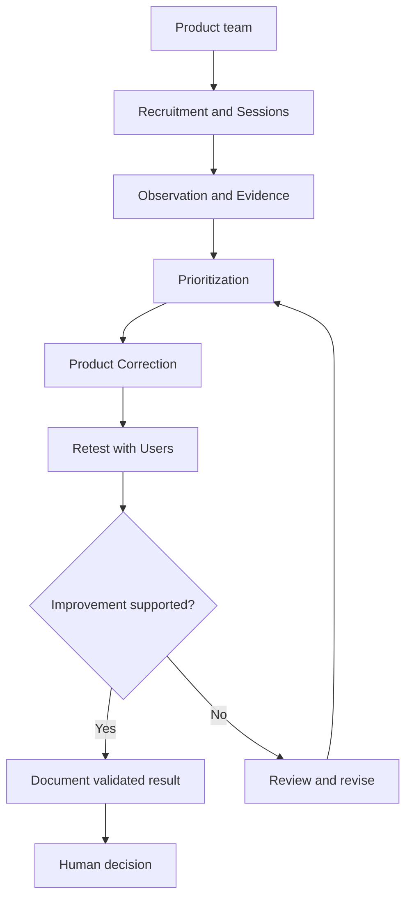

# FIELDPROOF — WEEK 15 PACKET
## Distribution: Your Method Feeds Your Audience

## 1. Problem

Small product teams conduct interviews and usability sessions, but their evidence is often scattered across spreadsheets, documents, screenshots and messages.

This makes it difficult to connect what users actually do with product decisions, corrections and validation.

FieldProof organizes that process into a traceable workflow.

## 2. Exact User and Payer

**Primary user:** Mexican founders, product managers, UX/UI designers and small digital agency teams that conduct occasional user research without dedicated research operations.

**Primary payer:** The founder, product lead or agency owner responsible for product quality and delivery.

**Moment of need:** Immediately after a usability session, when the team needs to document behavior, identify friction and decide what to improve.

## 3. Success Definition

- A first-time user understands the purpose of FieldProof.
- The user can navigate the four existing research modules.
- Observations can be distinguished from interpretations.
- Findings are supported by real research evidence.
- Product corrections can be documented and retested.
- Three finished content assets communicate the product.
- Two assets are tested with the intended audience.
- Results are reported honestly, including zero responses.

## 4. Positioning and Promise

**Positioning:** FieldProof is a lightweight evidence workspace for small product teams that need to connect real user sessions with better product decisions.

**Promise:** Organize real sessions, document observations, prioritize friction and track improvements.

**Promise we will not make:** We will not guarantee product success, automatic truth, representative findings or improved revenue without evidence.

## 5. Current Product and Scope

Existing modules:

1. Recruitment and Sessions.
2. Evidence and Observation.
3. Pain Ranking and Prioritization.
4. Impact Tracking and Validation.

The current release is a browser-based prototype hosted on GitHub Pages.

It does not claim secure cloud storage, automatic transcription, enterprise authentication or AI-generated research findings.

**Scope cut:**

- No new business.
- No participant marketplace.
- No payment system.
- No complex enterprise integrations.
- No automated research conclusions.
- No unnecessary collection of personal data.

## 6. Architecture and Stack

**Deployment:** GitHub Pages.

**Current implementation:** Static HTML, CSS and JavaScript pages.

**Main files:**
- index.html
- sessions.html
- observation.html
- pain-ranking.html
- impact-tracker.html

**Data handling:** The current observation workflow indicates local browser downloads rather than server-side storage.

No database or backend capability is claimed unless independently implemented and verified.

## 7. Research Workflow

## 8. Global Benchmark

### Maze
Strength: Combines usability testing, recruitment and research analysis.

FieldProof adaptation: A simpler workflow focused on traceability rather than advanced analytics.

Website: https://maze.co/

### Lookback
Strength: Connects user sessions, recordings and observations.

FieldProof adaptation: Preserve the connection between observed behavior and findings without claiming recording capabilities that do not currently exist.

Website: https://lookback.io/

### UserTesting
Strength: Provides access to participant feedback and user testing workflows.

FieldProof adaptation: Start with teams bringing their own participants instead of promising a managed participant network.

Website: https://www.usertesting.com/

## 9. Mexican Market Adaptation

FieldProof initially targets small Mexican product teams and digital agencies.

Design decisions:

- Clear and accessible language.
- Simple navigation.
- Lightweight browser-based access.
- Minimal participant data collection.
- Clear consent and privacy information.
- Exportable research records.
- No dependence on expensive enterprise infrastructure.

The OECD's 2026 Mexico Economic Survey identifies differences in digital technology adoption by firm size. This supports exploring simpler tools for smaller organizations, but does not independently establish demand for FieldProof.

## 10. Brand and Distribution

**Main message:** Evidence before assumptions.

**Brand voice:**
1. Specific, not exaggerated.
2. Evidence-led.
3. Practical and respectful.

**Visual system:**
- Navy: #102A4C
- Blue: #1F5A9D
- Teal: #16A69A
- Pale blue: #EAF4F8
- Clean sans-serif typography.
- Consistent cards and simple diagrams.

### Three Content Series

**Series 1 — Evidence, Not Assumptions**
- A quote is not the whole story.
- Observation versus interpretation.

**Series 2 — From Friction to Fix**
- How to prioritize usability problems.
- Why every correction needs a retest.

**Series 3 — Research Integrity**
- Why consent matters.
- Why synthetic evidence must never be presented as real.

### Three Finished Assets

1. Static educational post: A quote is not the whole story.
2. Four-slide carousel: From friction to fix.
3. Thirty-second video: Trust starts before the recording.

At least two formats are used.

### Distribution Test

Intended audience: Mexican founders, product managers, UX/UI designers and small digital agencies.

Test two finished assets through an appropriate professional channel or opt-in outreach.

Measure:
- Reach.
- Link clicks.
- Replies.
- Questions.
- Interest registrations.

Actual results remain pending until the tests are performed. Zero response is valid evidence.

## 11. Creative Production Process

The process turns an input into useful, on-brand content.

1. Research: verify the original information.
2. Writing: create a clear message.
3. Visual production: apply the brand system.
4. Claim checking: verify factual statements.
5. Style review: remove exaggerated claims and jargon.
6. Revision: human approval before publication.

Separate AI conversations can support these roles. No paid agent framework is required.

## 12. Testing Plan

### Mechanical testing
- Check all navigation links.
- Open all four product modules.
- Test observation form fields.
- Test local record downloads.
- Verify empty states.
- Check desktop and mobile layouts.

### Persona testing
Use a research-grounded synthetic persona.

Ask the persona to:
1. Understand the homepage.
2. Find the sessions module.
3. Create a sample observation.
4. Distinguish observation from interpretation.
5. Find prioritization and validation.

Record confusion and revisions. Clearly label all simulated evidence.

### Real audience testing
Show two content assets to the intended audience and record actual behavior.

A synthetic persona does not replace real audience evidence.

## 13. Shadow Clause and Security

The main risk is creating false confidence through invented, incomplete or AI-generated research evidence.

Design safeguards:

- Separate observations from interpretations.
- Never invent participant quotes.
- Clearly label demo data.
- Obtain informed consent.
- Avoid unnecessary personal information.
- Protect exported records.
- Require human approval before publication.

No secrets in public code. No real personal information in the public demo. Any future database must implement authentication, authorization and appropriate row-level security.

## 14. Generated Mockup

The Week 15 generated mockup is included in:

`assets/fieldproof-week15-mockup.png`

It represents the intended visual direction: a modern research workspace, four-step workflow, evidence snapshot and clear product navigation.

It is a generated design reference, not a screenshot of the deployed product.

## 15. Three-Year Direction

**Year 1:** Validate the core workflow, improve onboarding and establish research templates.

**Year 2:** Explore secure collaboration and team workspaces if demand is demonstrated.

**Year 3:** Consider responsible AI-assisted research organization, with traceability to original evidence and mandatory human review.

## 16. Release and Evidence

Live release:
https://sebassss2003-ux.github.io/FieldProof/

Repository:
https://github.com/sebassss2003-ux/FieldProof

The project retains its existing development history.

Deployment history and audience testing must be verified using actual repository and distribution evidence before final submission.
